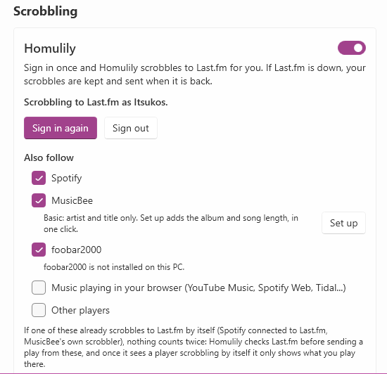

<p align="center">
  
</p>

<h1 align="center">Homulily Desktop</h1>

<p align="center">
  Scrobble Apple Music, Spotify, MusicBee and foobar2000 to Last.fm through the <a href="https://discord.gg/qbUDe9NN9v">Homulily</a> Discord bot,<br>
  and show what you are playing as your Discord status.
</p>

<p align="center">
  <a href="https://github.com/Itsukos/Homulily-Desktop/releases/latest"><b>Download for Windows</b></a>
  &nbsp;·&nbsp;
  <a href="https://discord.com/oauth2/authorize?client_id=1572268955475771443&scope=bot+applications.commands&permissions=378944">Add Homulily to Discord</a>
  &nbsp;·&nbsp;
  <a href="https://discord.gg/qbUDe9NN9v">Support server</a>
</p>

---

## What it does

- **Scrobbles to Last.fm for you.** Sign in with Discord once. Homulily sends your scrobbles to Last.fm with the login you gave it, so no Last.fm password or API key ever goes into this app.
- **Loses nothing when Last.fm is down.** Homulily keeps your scrobbles in your history and sends them, with their real times, once Last.fm answers again. If Homulily itself cannot be reached, they wait on your PC.
- **Keeps `.fm` working during outages.** Homulily shows what this app says you are playing, cover included.
- **Shows your music on Discord.** Song, artist and album cover as your status, for Apple Music, MusicBee, foobar2000 and music in your browser.
- **Never scrobbles twice.** If a player already scrobbles to Last.fm by itself, Homulily notices and stops sending its plays (see [below](#no-double-scrobbles)).
- **Updates itself.** One click, or fully automatic (on by default). Every download is checked against GitHub's checksum before it replaces the old version.

## Add Homulily to your server

This app works through **Homulily**, a Discord bot for music people: Last.fm stats with `/fm`, charts, top lists and
who-knows rankings for your server, plus AniList, fishing, collectible album cards and games. Add it to your server, link
Last.fm once, and this app does the rest.

<p><a href="https://discord.com/oauth2/authorize?client_id=1572268955475771443&scope=bot+applications.commands&permissions=378944"><b>Invite Homulily to your server</b></a> &nbsp;·&nbsp; questions go to the <a href="https://discord.gg/qbUDe9NN9v">support server</a></p>

## Getting started

1. [Download](https://github.com/Itsukos/Homulily-Desktop/releases/latest) `Homulily.Desktop.exe` and run it. Nothing to install: it lives in your system tray.
2. Double-click the tray icon to open Settings, and go to **Scrobbling**.
3. Press **Sign in with Discord**. If Homulily has no Last.fm login for you yet, Last.fm asks you to allow it. That is all.

<p align="center"></p>

In Discord, `.desktop` shows the download link and whether Homulily can scrobble for you yet.

> **Windows SmartScreen** may warn about an unrecognised app the first time, because the exe is not code-signed. Choose *More info*, then *Run anyway*. The source is all here if you would rather build it yourself.

## Supported players

| Player | How it is read | What you get |
|---|---|---|
| **Apple Music** (Microsoft Store app) | Directly from the app's window | Everything: song, album, length, cover, Discord status |
| **Spotify** | Windows' media controls | Song, album, length. Spotify shows its own Discord status |
| **MusicBee** | Its window title, or Windows' media controls after **Set up** | Artist and title at once. Album, length and your own cover after one-click Set up |
| **foobar2000** | Its window title, or Windows' media controls after **Set up** | Artist, album and title at once. Length and your own cover after one-click Set up |
| **Browsers** (YouTube Music, Spotify Web, Tidal...) | Windows' media controls | Song, usually album and length. Off by default |
| **Other players** | Windows' media controls | Whatever the player reports. Off by default |

**Set up** installs the small add-on MusicBee or foobar2000 needs to tell Windows what it plays: [mb_MediaControl](https://github.com/HenryPDT/mb_MediaControl) for MusicBee, [foo_mediacontrol](https://github.com/ungive/foo_mediacontrol) for foobar2000. Each is downloaded from its author's own release and checked before it is used.

## No double scrobbles

Spotify (when connected to Last.fm), MusicBee and foobar2000 can all scrobble by themselves, and this app cannot see whether yours does. So Homulily checks:

1. A play from anything but Apple Music is held for ten minutes.
2. Homulily then looks at your recent Last.fm scrobbles. If the same song is already there, the player sent it, so Homulily drops its copy. If not, Homulily sends it.
3. After a few matches in a row, Homulily marks that player as scrobbling by itself and only shows what you play there. It still checks now and then, so if you later disconnect Spotify from Last.fm, your plays are sent again.

## Privacy

- **Sent to Homulily:** what you are playing (song, artist, album, length), your scrobbles, and, for your Discord status, the album cover your player has. Covers are re-saved as plain pictures and kept for the 3,000 most recently played.
- **Stored on your PC:** your Homulily sign-in, in Windows Credential Manager; scrobbles waiting to be sent, in `%LOCALAPPDATA%\Homulily Desktop`; daily logs in the same folder.
- **Never in this app:** your Last.fm password or any API key.
- Sign out under Settings, Scrobbling, or with `.desktop off` in Discord. `/forgetme` in Discord erases what Homulily holds about you. Homulily's privacy policy: [homulily-bot-production.up.railway.app/privacy](https://homulily-bot-production.up.railway.app/privacy).

## Requirements

- Windows 11 24H2 or later, x64.
- For Apple Music: the [Microsoft Store version](https://apps.microsoft.com/detail/9PFHDD62MXS1) of the app.
- A Discord account in a server with Homulily ([invite it](https://discord.com/oauth2/authorize?client_id=1572268955475771443&scope=bot+applications.commands&permissions=378944)), and a Last.fm account.

## Troubleshooting

- **Nothing is scrobbled:** open Settings, Scrobbling. The line under the Homulily card says what is missing. In Discord, `.desktop` says the same.
- **No Discord status:** check *Enable Discord Rich Presence* under Discord RP, and that the player is ticked under *Also follow*. Apple Music takes over while it plays.
- **A player does not show up:** play something and look at Windows' media flyout (the volume or media button in the taskbar). If the player is not there, Windows does not know about it either; for MusicBee and foobar2000, press **Set up**.
- **Anything else:** logs are in `%LOCALAPPDATA%\Homulily Desktop`. Bring them to the [support server](https://discord.gg/qbUDe9NN9v).

## Building from source

Needs the [.NET 9 SDK](https://dotnet.microsoft.com/download/dotnet/9.0).

```powershell
.\BuildReleases.ps1
```

That publishes one self-contained `publish\Homulily Desktop.exe`. How the app works inside is in [TECHNICAL_DOCS.md](TECHNICAL_DOCS.md).

## Credits and license

Homulily Desktop is a fork of [AMWin-RP](https://github.com/PKBeam/AMWin-RP) by PKBeam and its contributors, who wrote the Apple Music reader, the Discord status, lyrics and the settings window this app is built on. Thank you.

Like AMWin-RP, Homulily Desktop is licensed under the [GNU General Public License v3.0](LICENSE).
